# Architecture

All components run in the `mlops` Kubernetes namespace, deployed via Kustomize
from `base/`. `base/` itself is cloud-agnostic: the `local-path-retain`
StorageClass and `ingressClassName: traefik` shown below are not defined in
`base/` — they're supplied by the `overlays/local` overlay via a Kustomize
patch, so the same `base/` can later be paired with an `overlays/eks/` that
patches in `gp3`/`alb` instead.

```mermaid
flowchart LR
    subgraph ns["Kubernetes namespace: mlops"]
        subgraph jup["jupyter (Deployment)"]
            jupC["notebook\njupyter/minimal-notebook"]
        end
        jupPVC[("jupyter-pvc\n5Gi")]
        jupSvc["jupyter-service\nClusterIP 8888"]

        subgraph mlf["mlflow (Deployment)"]
            mlfC["mlflow\nghcr.io/mlflow/mlflow:v2.11.3\n:5000"]
        end
        mlfSvc["mlflow-service\nClusterIP 5000"]

        subgraph db["mlflow-db (StatefulSet)"]
            dbC["postgres:15\n:5432"]
        end
        dbPVC[("mlflow-db-pvc\n5Gi")]
        dbSvc["mlflow-db-service\nClusterIP 5432"]

        subgraph mio["minio (StatefulSet)"]
            mioC["minio/minio\nS3 API :9000 · Console :9001"]
        end
        mioPVC[("minio-pvc\n10Gi")]
        mioSvc["minio-service\nClusterIP 9000/9001"]

        subgraph dash["dashboard (Deployment)"]
            dashC["nginx:alpine\n:80"]
        end
        dashSvc["dashboard-service\nClusterIP 80"]
        dashCm["ConfigMap\ndashboard-html\n(generated from index.html)"]

        sc["StorageClass\nlocal-path-retain\n(from overlays/local)"]

        cm["ConfigMap\nplatform-config\n(config/.env.config)"]
        sec["Secret\nplatform-secrets\n(secrets/.env.secrets)"]

        jupIng["Ingress\njupyter-ingress\njupyter.local"]
        mlfIng["Ingress\nmlflow-ingress\nmlflow.local"]
        mioIng["Ingress\nminio-ingress\nminio.local\nminio-console.local"]
        dashIng["Ingress\ndashboard-ingress\nmlops.local"]
    end

    user(["User / Browser"])

    user -- "mlops.local" --> dashIng --> dashSvc
    user -- "jupyter.local" --> jupIng --> jupSvc
    user -- "mlflow.local" --> mlfIng --> mlfSvc
    user -- "minio(-console).local" --> mioIng --> mioSvc

    dashSvc --> dashC
    dashCm -. "index.html" .-> dashC
    dashC -. "links to" .-> jupIng & mlfIng & mioIng

    jupSvc --> jupC
    mlfSvc --> mlfC
    mioSvc --> mioC

    jupC -- "logs runs\n(mlflow SDK)" --> mlfSvc

    mlfC -- "backend-store-uri\npostgresql://mlflow_user@...:5432/mlflow" --> dbSvc --> dbC
    mlfC -- "default-artifact-root\ns3://mlflow/ via MLFLOW_S3_ENDPOINT_URL" --> mioSvc --> mioC

    jupC -.-> jupPVC
    dbC -.-> dbPVC
    mioC -.-> mioPVC
    jupPVC & dbPVC & mioPVC -.-> sc

    cm -. "env" .-> mlfC & dbC
    sec -. "env" .-> jupC & mlfC & dbC & mioC
```

## Flow

- **Dashboard** is the entry point (`mlops.local`) — a static nginx page with
  links out to MLflow, Jupyter, and the MinIO console. Its HTML is generated
  into the `dashboard-html` ConfigMap by Kustomize's `configMapGenerator`
  from `base/dashboard/index.html`, so the page content lives in git as a
  plain file rather than embedded YAML; editing it produces a new ConfigMap
  hash and rolls the Deployment.
- **Jupyter** is where experiments run; it uses the MLflow SDK to log runs to
  the tracking server.
- **MLflow** persists run/experiment metadata to **Postgres** (`mlflow-db`)
  and writes artifacts (models, files) to **MinIO** over the S3 API.
- All stateful components (`jupyter`, `mlflow-db`, `minio`) mount PVCs backed
  by the `local-path-retain` StorageClass, so data survives pod restarts.
  `storageClassName` isn't set on the PVCs in `base/` — it's patched in by
  `overlays/local` (see note above), keeping the PVC definitions portable.
- Everything user-facing sits behind a Traefik `Ingress` on a `*.local`
  hostname (`mlops.local`, `jupyter.local`, `mlflow.local`,
  `minio.local`/`minio-console.local`); the Services themselves are
  `ClusterIP`-only, same as the internal-only `mlflow-db`. `NodePort` is
  commented out in each `service.yaml` rather than removed, in case ingress
  needs to be bypassed. `ingressClassName: traefik` is likewise patched in by
  `overlays/local` for most Ingresses (`dashboard-ingress` currently still
  hardcodes it in `base/` — a known inconsistency, see README known gaps).
- Non-sensitive settings (DB name, MinIO endpoint URL, TLS flag, `PYTHONPATH`)
  come from the `platform-config` ConfigMap; credentials (Postgres user/pass,
  MinIO root user/pass, Jupyter token) come from the `platform-secrets`
  Secret. Both are generated by Kustomize from `base/config/.env.config` and
  `base/secrets/.env.secrets`, and injected into containers via
  `configMapKeyRef`/`secretKeyRef` — no plaintext values live in the
  Deployment/StatefulSet specs.
- Not shown in the diagram above (omitted to keep it focused on traffic/data
  flow): every pod runs under its own dedicated `ServiceAccount` rather than
  the namespace's `default`. Only `jupyter`'s has its token automounted, and
  only `jupyter` has any RBAC grant at all — a namespace-scoped `Role`/
  `RoleBinding` giving read-only access to `pods`. See the README's RBAC
  section for the full rationale.
