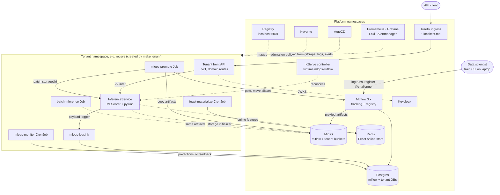
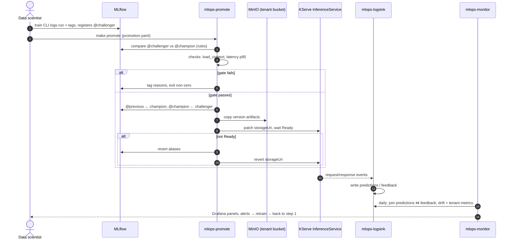
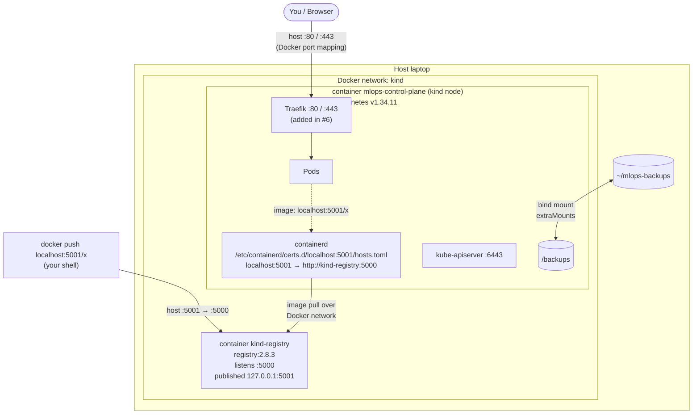

# Architecture

## Target architecture
The design is in [`platform-PRD.md`](platform-PRD.md). Tenants touch the platform only
through the contract (§3): Secrets, Kustomize components, labels and policy files.



### Model lifecycle


Phases and what each one builds: [`platform-PRD.md` §8](platform-PRD.md#8-phases).
Work tracking: [project board](https://github.com/users/asdyns/projects/3).

## Local cluster layout (kind, #5)
The local platform runs as a kind cluster. kind runs each Kubernetes node as a
Docker container, so there are two networks to think about: the Docker host
ports you reach from your laptop, and the Kubernetes network inside the node.
A separate registry container holds the images you build locally.

Ports:

| Where | Port | Meaning |
|---|---|---|
| host `127.0.0.1:5001` | → `kind-registry:5000` | `docker push localhost:5001/...` from your shell |
| host `:80` / `:443` | → node `:80` / `:443` | web traffic into the cluster (Traefik, #6) |
| host random localhost port | → node `:6443` | Kubernetes API (`kubectl`), written to `~/.kube/config` |
| `kind-registry:5000` | Docker network `kind` | how containerd on the node pulls images |



## Current state (v0, k3s)
All components run in the `mlops` Kubernetes namespace, deployed via Kustomize
from `base/`. `base/` itself is cloud-agnostic: the `local-path-retain`
StorageClass and `ingressClassName: traefik` shown below are not defined in
`base/` — they're supplied by the `overlays/local` overlay via a Kustomize
patch, so the same `base/` can later be paired with an `overlays/eks/` that
patches in `gp3`/`alb` instead.


### Flow

- **Dashboard** is the entry point (`mlops.local`) — a static nginx page with
  links out to MLflow, Jupyter, and the MinIO console. Its HTML is generated
  into the `dashboard-html` ConfigMap by Kustomize's `configMapGenerator`
  from `base/dashboard/index.html`, so the page content lives in git as a
  plain file rather than embedded YAML; editing it produces a new ConfigMap
  hash and rolls the Deployment.
- **Jupyter** is where experiments run; it uses the MLflow SDK to log runs to
  the tracking server.
- **MLflow** persists run/experiment metadata to **Postgres** (`mlflow-db`)
  and writes artifacts (models, files) to **MinIO** over the S3 API.
- All stateful components (`jupyter`, `mlflow-db`, `minio`) mount PVCs backed
  by the `local-path-retain` StorageClass, so data survives pod restarts.
  `storageClassName` isn't set on the PVCs in `base/` — it's patched in by
  `overlays/local` (see note above), keeping the PVC definitions portable.
- Everything user-facing sits behind a Traefik `Ingress` on a `*.local`
  hostname (`mlops.local`, `jupyter.local`, `mlflow.local`,
  `minio.local`/`minio-console.local`); the Services themselves are
  `ClusterIP`-only, same as the internal-only `mlflow-db`. `NodePort` is
  commented out in each `service.yaml` rather than removed, in case ingress
  needs to be bypassed. `ingressClassName: traefik` is likewise patched in by
  `overlays/local` for most Ingresses (`dashboard-ingress` currently still
  hardcodes it in `base/` — a known inconsistency, see README known gaps).
- Non-sensitive settings (DB name, MinIO endpoint URL, TLS flag, `PYTHONPATH`)
  come from the `platform-config` ConfigMap; credentials (Postgres user/pass,
  MinIO root user/pass, Jupyter token) come from the `platform-secrets`
  Secret. Both are generated by Kustomize from `base/config/.env.config` and
  `base/secrets/.env.secrets`, and injected into containers via
  `configMapKeyRef`/`secretKeyRef` — no plaintext values live in the
  Deployment/StatefulSet specs.
- Not shown in the diagram above (omitted to keep it focused on traffic/data
  flow): every pod runs under its own dedicated `ServiceAccount` rather than
  the namespace's `default`. Only `jupyter`'s has its token automounted, and
  only `jupyter` has any RBAC grant at all — a namespace-scoped `Role`/
  `RoleBinding` giving read-only access to `pods`. See the README's RBAC
  section for the full rationale.

### RBAC
Every workload runs under its own dedicated `ServiceAccount` — none of them use
the namespace's `default` ServiceAccount, which is intentionally left unbound
so it can never become an accidental shared grant. `automountServiceAccountToken`
is `false` on all of them except `jupyter`, since none of the others make calls
to the Kubernetes API.

`jupyter`'s ServiceAccount is bound (via a `Role` + `RoleBinding`, both scoped to
the `mlops` namespace) to read-only access on `pods` — `get`/`list`/`watch` only,
nothing else. This is deliberately minimal for now; a `Role` covering `batch/v1`
Jobs will be added once notebooks start kicking off training runs as Kubernetes
Jobs.

This per-app ServiceAccount split isn't just isolation for its own sake — it
maps directly onto AWS IRSA (IAM Roles for Service Accounts), which annotates
individual ServiceAccounts to assume individual IAM roles. Keeping each
workload on its own identity now means `overlays/eks/` can add IRSA annotations
to existing ServiceAccounts rather than needing to first split workloads that
share one.

### k3s troubleshooting (v0)
**Ingress returns 502 Bad Gateway on every `*.local` host.** Most likely your
machine's IP has changed (DHCP lease renewal) since the `*.local` entries were
added to `/etc/hosts`. Check the two things below, in order:

1. Confirm Traefik's current address and match `/etc/hosts` to it:
   ```
   kubectl get svc -n kube-system traefik   # note the EXTERNAL-IP
   ```
   Update each `*.local` line in `/etc/hosts` to that IP.
2. If ingress still 502s after that, the IP change may have also broken k3s's
   internal pod-network routing (Traefik unable to reach the API server's
   ClusterIP) — check `kubectl logs -n kube-system -l app.kubernetes.io/name=traefik`
   for `no route to host` errors. Fix with a clean k3s restart (plain
   `systemctl restart k3s` can leave orphaned `containerd-shim` processes behind):
   ```
   sudo /usr/local/bin/k3s-killall.sh
   sudo systemctl start k3s
   ```
   Give it 30-60s, then recheck `kubectl get nodes` and `kubectl get pods -n mlops`.
